<h1 align="center">Avinash Phadtare</h1>

  <strong>AI/ML Diploma Student · Data Analysis → Machine Learning → NLP → Deep Learning</strong>

  Building the foundations (Python, data analysis, math) to become an AI Engineer, and shipping real projects on the way.

<a href="https://github.com/AvinashPhadtare">
  <picture>
    <source media="(prefers-color-scheme: dark)" srcset="https://raw.githubusercontent.com/AvinashPhadtare/AvinashPhadtare/main/dark.svg">
    <source media="(prefers-color-scheme: light)" srcset="https://raw.githubusercontent.com/AvinashPhadtare/AvinashPhadtare/main/light.svg">
    
  </picture>
</a>

---

## 👋 About Me

Hi, I'm Avinash. I'm a second-year diploma student in Artificial Intelligence and Machine Learning, from India.

I like making things that really work, and I like knowing why they work. This page is a short story of where I started, where I am right now, and where I want to go.

### 🛤️ My Journey

It started with C. C was my first language, and it showed me how a computer thinks, one small step at a time.

Then I fell in love with Python. I could solve real problems with it, and I could be creative while doing it.

After that, I learned to build the back part of an app, the part users never see. I used FastAPI and PostgreSQL for it. I also picked up some frontend, so I could see how a whole app fits together. With these skills, I built my own projects and put them online, like a student result dashboard and a restaurant management system. You can find them below.

Next came data. I learned NumPy, Pandas, Matplotlib, and Seaborn. Now I can take a dataset, clean it, look for patterns in it, and show what I found with charts.

### 🏁 My Goal

I want to become an AI Engineer.

For me, that means building AI that works in real life, and knowing what is going on inside it. I don't want to only use a library and hope it works. I want to understand machine learning, deep learning, and the math behind them. Then, when a model gives a wrong answer, I'll know why, and I'll know how to fix it.

### 📍 Where I Am Today

Here is where I stand right now:

- I'm comfortable with Python, and I can build full apps with FastAPI and a database.
- I can do data analysis with NumPy, Pandas, Matplotlib, and Seaborn.
- I'm just starting machine learning. I'm beginning with the math behind it, and then the main ML algorithms.

## 🧰 Skills

## 🧰 Languages & Tools

  
  &nbsp;
  &nbsp;
  &nbsp;

---

## 🎯 Current Focus

Right now I'm building the base that machine learning stands on:

- 📐 The math behind ML: linear algebra, probability, and statistics
- 🤖 The main ML algorithms, and how they work inside
- 📊 Data analysis on real datasets, to keep my basics sharp

---

## 🔭 Next Goal

My next goal is to turn what I learn into working projects, one step at a time:

- 🧪 Build my first ML projects, using scikit-learn
- 💬 Learn NLP (how computers work with human language) and build NLP models
- 🧠 Learn deep learning and build models with it
- 🏗️ Use everything I've learned to build bigger models, then go as deep into AI Engineering as I can

---

## 🚀 Featured Projects

### 📊 Student Result Analysis

**A dashboard that shows how students are doing in their exams.**

You give it student marks, and it turns the numbers into answers. It shows who topped the class, what percent passed or failed, and how many students got each grade. Every student also gets a radar chart (a web-shaped chart) that shows their marks in all subjects at a glance. You can look at the numbers subject by subject too.

- ⚡ Backend built with FastAPI
- 🐬 MySQL database, hosted on Aiven
- 📈 Data analysis and charts on student marks

🔗 **Live project:** https://student-result-analysis-frontend.vercel.app/

---

### 🧩 Universal Dataframe Loader in Pandas

**One function call to load data from almost anywhere.**

Data comes in many forms: CSV files, Excel sheets, JSON, databases, and web APIs. Normally you need different code for each one. This Python package does that work for you. You give it a source, it figures out the type, and it loads the data into a Pandas DataFrame (a table you can work with in Python).

What it can load:

- 📄 CSV, Excel, JSON, and text files with separators. It finds the type from the file extension or the content.
- 🗄️ SQL databases, using any SQLAlchemy connection string
- 🌐 REST APIs that send data in pages. You tell it how the paging works (offset, page number, cursor, or next link), and it loads page after page.

🔗 **GitHub:** https://github.com/AvinashPhadtare/Universal_dataframe_loader_in_pandas

---

### 🍽️ AURAA RESTO

**A restaurant management system.**

A full web app, front and back, for running a restaurant. It's built with:

- ⚡ FastAPI for the backend
- 🐘 PostgreSQL for the database
- 🔐 JWT login, a safe way to keep track of who is logged in
- 🛠️ An admin dashboard to manage the restaurant

🔗 **Live project:** https://auraa-resto-management.vercel.app/menu?table=1 (this link opens the menu for table 1)

---

## 📊 GitHub Activity

I try to build a little every day. This is how that's going:

  

---

## 📫 Connect With Me

Want to talk about a project, an idea, or learning AI? I'd love to hear from you.

- 📧 **Email:** [phadtareavinash2008@gmail.com](mailto:phadtareavinash2008@gmail.com)
- 💼 **LinkedIn:** [avinash-phadtare](https://www.linkedin.com/in/avinash-phadtare/)
- 🐦 **X:** [@Avi_Phadtare](https://x.com/Avi_Phadtare)
- 🧑‍💻 **Hackerrank:** [@phadtareavinash1](https://www.hackerrank.com/profile/phadtareavinash1)

---

### 💭 Philosophy
> I like solving problems in creative ways, and I'll always pick clear and simple over complicated. I learn fastest by building something, putting it online, and making it better. My aim is to make things that really work in the real world.
